---

# 🚗 Sistema de Aluguel de Carros 👨‍💻

> [!NOTE]
> Sistema web para gestão de aluguéis de automóveis: clientes fazem, modificam, consultam e cancelam pedidos pela Internet; agentes (empresas e bancos) analisam financeiramente os pedidos, executam os contratos e concedem crédito.

<table>
  <tr>
    <td width="800px">
      <div align="justify">
        Projeto desenvolvido no <b>Laboratório 02</b> da disciplina <b>Desenvolvimento e Integração de Aplicações Web (DIAW)</b> do curso de <b>Engenharia de Software da PUC Minas</b>. A aplicação segue a arquitetura <i>MVC</i>, com back-end em <b>Spring Boot</b> (Java 25), front-end em <b>React + Vite</b> e banco de dados <b>PostgreSQL no Supabase</b>. O acesso é restrito a usuários cadastrados (<i>login com usuário e senha</i>) e cada perfil — <b>Cliente</b>, <b>Empresa</b> ou <b>Banco</b> — enxerga apenas as funcionalidades que lhe cabem. A modelagem UML (casos de uso, histórias de usuário, classes e pacotes) foi produzida antes da implementação e revisada ao longo do projeto, mantendo o alinhamento entre modelo e código.
      </div>
    </td>
    <td>
      <div>
        
      </div>
    </td>
  </tr>
</table>

---

## 🚧 Status do Projeto

         

✅ Protótipo funcional concluído: autenticação, CRUD de clientes, automóveis, pedidos com status, avaliação financeira, contratos e crédito.

---

## 📚 Índice
- [Links Úteis](#-links-úteis)
- [Sobre o Projeto](#-sobre-o-projeto)
- [Funcionalidades Principais](#-funcionalidades-principais)
- [Tecnologias Utilizadas](#-tecnologias-utilizadas)
- [Modelagem do Sistema](#-modelagem-do-sistema)
- [Arquitetura](#-arquitetura)
- [Instalação e Execução](#-instalação-e-execução)
  - [Pré-requisitos](#pré-requisitos)
  - [Variáveis de Ambiente](#-variáveis-de-ambiente)
  - [Instalação de Dependências](#-instalação-de-dependências)
  - [Inicialização do Banco de Dados (Supabase)](#-inicialização-do-banco-de-dados-supabase)
  - [Como Executar a Aplicação](#-como-executar-a-aplicação)
- [Deploy](#-deploy)
- [Estrutura de Pastas](#-estrutura-de-pastas)
- [Demonstração](#-demonstração)
- [Testes](#-testes)
- [Documentações utilizadas](#-documentações-utilizadas)
- [Autores](#-autores)
- [Contribuição](#-contribuição)
- [Agradecimentos](#-agradecimentos)
- [Licença](#-licença)

---

## 🔗 Links Úteis
* 📖 **Histórias de Usuário:** [docs/historias-usuario.md](docs/historias-usuario.md)
* 🧩 **Diagramas UML (versão atual):** [docs/diagramas/v2](docs/diagramas/v2)
* 🗂️ **Diagramas UML (versão inicial):** [docs/diagramas/v1](docs/diagramas/v1)
* 📄 **Enunciado:** [Laboratório 02 — Sistema de Aluguel de Carros](Laborat%C3%B3rio%2002%20Sistema%20de%20Aluguel%20de%20Carros.pdf)

---

## 📝 Sobre o Projeto

Uma locadora precisa apoiar a **gestão de aluguéis de automóveis pela Internet**. Hoje, pedido, análise de crédito e contrato acontecem em etapas separadas; o sistema reúne tudo em um só fluxo:

1. O **cliente** se cadastra informando seus dados de identificação (RG, CPF, nome, endereço), profissão e até **3 rendimentos** com as respectivas entidades empregadoras.
2. O cliente escolhe um automóvel e o período e cria um **pedido de aluguel**, que nasce com status **PENDENTE**.
3. Um **agente** (empresa ou banco) analisa o pedido do ponto de vista financeiro — com a renda do cliente à vista — e registra um **parecer**, aprovando ou reprovando.
4. Pedidos aprovados são colocados à consideração do agente para **execução do contrato**. Dependendo do tipo de contrato, o automóvel passa a ser registrado em nome do **cliente**, da **empresa** ou do **banco**.
5. Opcionalmente, um **banco** associa um **contrato de crédito** ao aluguel, com valor, taxa de juros e número de parcelas.

O contexto é **acadêmico** (Laboratório 02 de DIAW), mas o fluxo reproduz um cenário real de locadoras que trabalham com financiamento bancário.

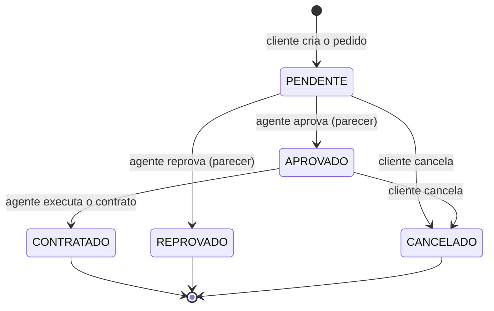

---

## ✨ Funcionalidades Principais

- 🔐 **Autenticação:** cadastro e login com usuário e senha (senha com BCrypt, sessão via token JWT). Nenhuma tela além de login/cadastro é acessível sem autenticação.
- 👥 **Perfis de acesso:** Cliente, Empresa e Banco, cada um com seu menu e suas permissões (validadas também no back-end).
- 🧑‍💼 **CRUD de Clientes:** o cliente mantém os próprios dados; os agentes listam, cadastram, editam e excluem clientes. Validação de CPF, RG/CPF únicos e **no máximo 3 rendimentos**.
- 🚘 **Automóveis:** cadastro com matrícula, ano, marca, modelo e placa (padrão antigo ou Mercosul).
- 📝 **Pedidos de aluguel:** o cliente cria, modifica (enquanto pendente), consulta e cancela pedidos; o sistema impede reservas sobrepostas do mesmo automóvel.
- 📊 **Análise financeira:** agentes filtram os pedidos por status e aprovam/reprovam com parecer, vendo a renda total e os rendimentos do cliente.
- 📃 **Contratos:** execução do contrato de pedidos aprovados, registrando o automóvel em nome do cliente, da empresa ou do banco.
- 🏦 **Contrato de crédito:** bancos concedem crédito ao contrato; a parcela é calculada pela Tabela Price.
- 📊 **Painel inicial (dashboard):** indicadores (pedidos, valor contratado e financiado) e gráficos de pedidos por status e de contratos por mês.
- 🧭 **Linha do tempo do pedido:** etapas criação → análise → contrato → crédito, com datas e responsáveis.
- 🗂️ **Navegação lateral:** barra lateral recolhível com ícones por seção (gaveta no celular).

---

## 🛠 Tecnologias Utilizadas

### 💻 Front-end

* **Framework/Biblioteca:** React 19
* **Linguagem:** JavaScript (ES2022+, JSX)
* **Roteamento:** React Router 7
* **Requisições HTTP:** Axios 1 (interceptor que envia o token JWT)
* **Estilização:** Tailwind CSS 4
* **Componentes de interface:** [shadcn/ui](https://ui.shadcn.com/) (Radix UI) — Button, Card, Table, Tabs, Badge, Alert, AlertDialog, RadioGroup, DropdownMenu
* **Ícones e notificações:** Lucide React e Sonner (toasts)
* **Gráficos:** Recharts (componente Chart do shadcn/ui)
* **Gerenciamento de Estado:** Context API (`AuthProvider`)
* **Build Tool:** Vite 6

### 🖥️ Back-end

* **Linguagem/Runtime:** Java 25 (JDK 25)
* **Framework:** Spring Boot 4.0.9 (Spring Web MVC, Spring Data JPA, Spring Security, Bean Validation)
* **Build e dependências:** Apache Maven (Maven Wrapper `./mvnw`)
* **Banco de Dados:** PostgreSQL 17 hospedado no **Supabase**
* **ORM:** Hibernate / JPA (herança `JOINED` para os tipos de usuário)
* **Migrações:** Flyway
* **Autenticação:** Spring Security + OAuth2 Resource Server (JWT assinado com HMAC-SHA256) + BCrypt
* **Utilitários:** Lombok

### ⚙️ Infraestrutura & DevOps

* **Banco gerenciado:** Supabase (PostgreSQL, conexão via *Session pooler*)
* **Versionamento:** Git + GitHub
* **Modelagem UML:** PlantUML (+ Graphviz)

---

## 🧩 Modelagem do Sistema

A modelagem foi feita antes da implementação (**v1**) e revisada durante o desenvolvimento (**v2**). Ambas as versões estão versionadas em [`docs/diagramas`](docs/diagramas), em código-fonte PlantUML (`.puml`) e imagem (`.png`).

| Artefato | Versão atual | Versão inicial |
| :--- | :---: | :---: |
| Histórias de Usuário | [historias-usuario.md](docs/historias-usuario.md) (v2) | — |
| Diagrama de Casos de Uso | [v2](docs/diagramas/v2/casos-de-uso.png) | [v1](docs/diagramas/v1/casos-de-uso.png) |
| Diagrama de Classes | [v2](docs/diagramas/v2/classes.png) | [v1](docs/diagramas/v1/classes.png) |
| Diagrama de Pacotes (Visão Lógica) | [v2](docs/diagramas/v2/pacotes.png) | [v1](docs/diagramas/v1/pacotes.png) |

### Diagrama de Casos de Uso (v2)

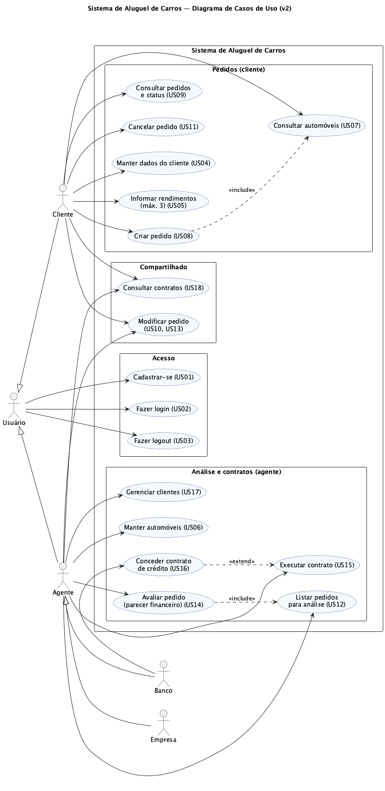

### Diagrama de Classes (v2)

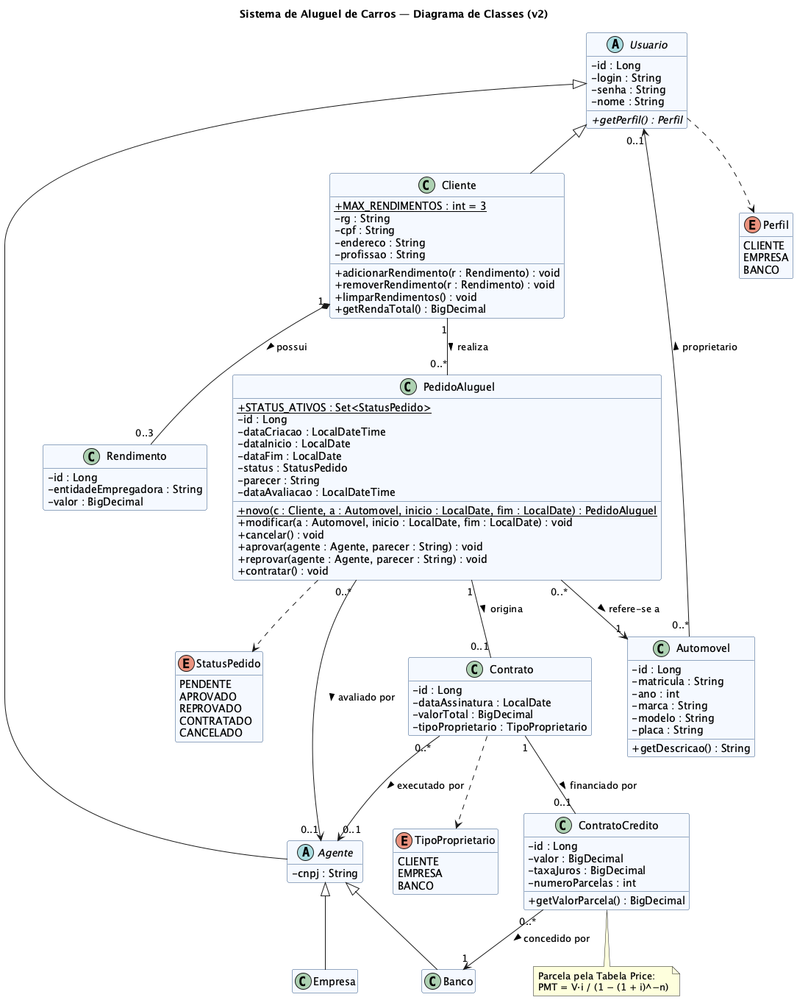

### 🔄 Modificações entre o modelo inicial (v1) e o final (v2)

| Diagrama | Modificação | Motivo |
| :--- | :--- | :--- |
| Casos de Uso | Novo caso **Gerenciar clientes (US17)** para o agente | O CRUD de cliente exigido no enunciado também é útil para os agentes, que precisam consultar os dados financeiros dos contratantes. |
| Casos de Uso | Novo caso **Consultar contratos (US18)** | Clientes e agentes precisavam acompanhar contratos e créditos já executados. |
| Classes | Associação **Contrato → Agente ("executado por")** | Registrar qual empresa/banco executou o contrato e validar em nome de quem o automóvel pode ser registrado. |
| Classes | `Automovel.isDisponivel()` substituído por verificação de **conflito de períodos** | A disponibilidade depende do período solicitado, então a regra passou para uma consulta no repositório (`PedidoAluguelRepository.existeConflito`) usada pelo `PedidoService`. |
| Classes | `Agente.avaliar(...)` e `Banco.concederCredito(...)` movidos | A avaliação virou responsabilidade do próprio pedido (`PedidoAluguel.aprovar/reprovar`), que controla suas transições de estado; a concessão de crédito ficou no `ContratoService`, que valida o perfil do usuário logado. |
| Classes | Novos métodos `PedidoAluguel.novo(...)` e `contratar()`, constantes `MAX_RENDIMENTOS` e `STATUS_ATIVOS` | Concentram no modelo as regras de criação, máximo de 3 rendimentos e status que ocupam o automóvel. |
| Pacotes | Detalhamento das classes de cada pacote e novos pacotes `utils`, `components/ui` (shadcn/ui) e `lib` no front-end | Deixar explícito o alinhamento entre a visão lógica e o código e registrar a padronização visual com shadcn/ui. |
| Histórias | Novas US17 e US18 e critérios de aceitação refinados | Regras descobertas durante a implementação (conflito de datas, limite do crédito ao valor do contrato, parcela pela Tabela Price). |

---

## 🏗 Arquitetura

O sistema é um **monólito em duas aplicações** que se comunicam por **HTTP/JSON (REST)**, seguindo o padrão **MVC** e dividido nos dois subsistemas pedidos no enunciado:

* **Subsistema de construção das páginas web (View)** — aplicação **React + Vite** que roda no navegador do cliente/agente e monta as páginas dinamicamente a partir dos dados da API.
* **Subsistema de gestão de pedidos e contratos (Controller + Model)** — API **Spring Boot** no servidor central, ligada ao banco **PostgreSQL (Supabase)**.

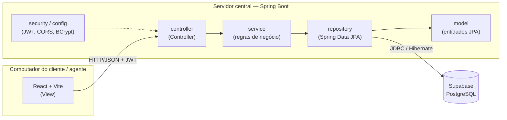

**Camadas do back-end (`com.aluguelcarros`)**

| Pacote | Papel |
| :--- | :--- |
| `controller` | Endpoints REST; recebem DTOs validados (`@Valid`) e aplicam autorização por perfil (`@PreAuthorize`). |
| `service` | Regras de negócio e transações (`@Transactional`): permissões por dono do recurso, conflito de datas, execução de contrato, crédito. |
| `repository` | Interfaces Spring Data JPA (consultas derivadas e JPQL). |
| `model` | Entidades JPA do diagrama de classes, com as regras de estado do pedido encapsuladas nos métodos (`aprovar`, `cancelar`, `contratar`...). |
| `dto` | *Records* de entrada (`*Request`) e saída (`*Response`), separando a API das entidades. |
| `security` / `config` | Geração e validação de JWT, usuário logado, CORS e `PasswordEncoder` (BCrypt). |
| `exception` | Exceções de negócio e `@RestControllerAdvice` que padroniza as respostas de erro. |

**Padrões adotados:** MVC, Service Layer, Repository, DTO, *Rich Domain Model* (regras de transição de status nas entidades), Factory Method (`PedidoAluguel.novo`) e herança `JOINED` (`Usuario → Cliente | Agente → Empresa | Banco`).

**Decisões e trade-offs**
* **Autenticação própria com JWT** (em vez do Supabase Auth): mantém usuários e perfis no modelo de classes e no MVC do Spring; o Supabase é usado apenas como banco PostgreSQL.
* **Flyway** versiona o schema (`V1__usuarios.sql`, `V2__pedidos_contratos.sql`) e o Hibernate apenas valida (`ddl-auto=validate`), evitando divergência entre modelo e banco.
* **API stateless**: o token fica no `localStorage` do navegador; ao expirar, o front-end encerra a sessão automaticamente.

### Diagrama de Pacotes (v2)

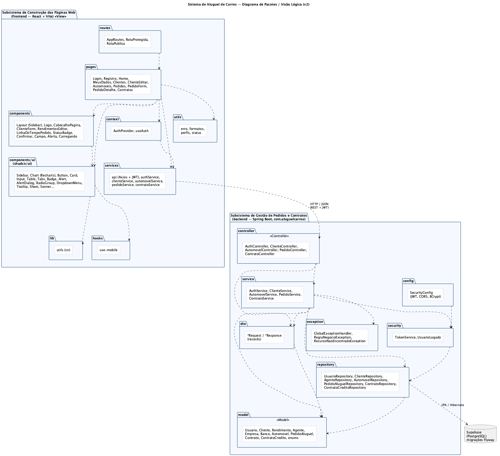

### 🌐 Endpoints da API

| Método | Rota | Perfil | Descrição |
| :--- | :--- | :--- | :--- |
| `POST` | `/api/auth/registro` | público | Cadastro de Cliente, Empresa ou Banco (retorna token) |
| `POST` | `/api/auth/login` | público | Login (retorna token JWT) |
| `GET` | `/api/auth/me` | autenticado | Dados do usuário logado |
| `GET` | `/api/clientes` | Empresa, Banco | Lista clientes |
| `GET` `PUT` `DELETE` | `/api/clientes/{id}` | Agente ou o próprio cliente | Consulta, atualiza ou exclui cliente |
| `POST` | `/api/clientes` | Empresa, Banco | Cadastra cliente |
| `GET` | `/api/automoveis` | autenticado | Lista automóveis |
| `POST` `PUT` `DELETE` | `/api/automoveis[/{id}]` | Empresa, Banco | Mantém automóveis |
| `GET` | `/api/pedidos` | autenticado | Cliente: seus pedidos · Agente: todos |
| `GET` `PUT` | `/api/pedidos/{id}` | dono ou agente | Consulta / modifica pedido |
| `POST` | `/api/pedidos` | Cliente | Cria pedido |
| `POST` | `/api/pedidos/{id}/cancelamento` | Cliente | Cancela pedido |
| `POST` | `/api/pedidos/{id}/avaliacao` | Empresa, Banco | Aprova/reprova com parecer |
| `POST` | `/api/pedidos/{id}/contrato` | Empresa, Banco | Executa o contrato |
| `GET` | `/api/contratos` | autenticado | Cliente: seus contratos · Agente: todos |
| `POST` | `/api/contratos/{id}/credito` | Banco | Concede contrato de crédito |

---

## 🔧 Instalação e Execução

### Pré-requisitos

* **Java JDK 25** (`java -version` deve mostrar 25)
* **Node.js** 20 ou superior e **npm**
* Uma conta gratuita no **[Supabase](https://supabase.com/)** com um projeto criado
* Maven não é obrigatório: o projeto inclui o **Maven Wrapper** (`./mvnw`)

> [!TIP]
> No macOS com Homebrew: `brew install openjdk@25` e defina `JAVA_HOME` apontando para `$(brew --prefix openjdk@25)/libexec/openjdk.jdk/Contents/Home`.

---

### 🔑 Variáveis de Ambiente

#### 1 Back-end (Spring Boot)

Copie [`backend/.env.example`](backend/.env.example) para **`backend/.env`** e preencha. O arquivo é lido automaticamente pelo Spring (`spring.config.import`) e **não é versionado**.

| Variável | Descrição | Exemplo |
| :--- | :--- | :--- |
| `DB_URL` | URL JDBC do Supabase (*Connect → Session pooler*) | `jdbc:postgresql://aws-0-us-east-1.pooler.supabase.com:5432/postgres?sslmode=require` |
| `DB_USER` | Usuário do Session pooler | `postgres.abcdefghijklmnop` |
| `DB_PASSWORD` | Senha do banco definida no Supabase | `sua-senha` |
| `JWT_SECRET` | Chave para assinar os tokens (mín. 32 caracteres) | gere com `openssl rand -base64 64` |
| `JWT_EXPIRATION_MS` | Validade do token em ms (opcional) | `86400000` (24 h) |

#### 2 Front-end (React, Vite)

Opcional: crie `frontend/.env` a partir de [`frontend/.env.example`](frontend/.env.example).

| Variável | Descrição | Padrão |
| :--- | :--- | :--- |
| `VITE_API_URL` | URL base da API Spring Boot | `http://localhost:8080/api` |

---

### 📦 Instalação de Dependências

```bash
git clone https://github.com/GuilhermeCostax/AlugelCarros.git
cd AlugelCarros
```

#### Front-end (React)

```bash
cd frontend
npm install
cd ..
```

#### Back-end (Spring Boot)

```bash
cd backend
./mvnw clean install -DskipTests
cd ..
```

---

### 💾 Inicialização do Banco de Dados (Supabase)

Não é preciso criar tabelas manualmente. Na primeira execução do back-end, o **Flyway** aplica as migrações em `backend/src/main/resources/db/migration`:

* `V1__usuarios.sql` — `usuario`, `cliente`, `agente`, `empresa`, `banco`, `rendimento`
* `V2__pedidos_contratos.sql` — `automovel`, `pedido_aluguel`, `contrato`, `contrato_credito`

---

### ⚡ Como Executar a Aplicação

#### Terminal 1: Back-end (Spring Boot)

```bash
cd backend
./mvnw spring-boot:run
```
🚀 *A API estará disponível em **http://localhost:8080/api**.*

#### Terminal 2: Front-end (React, Vite)

```bash
cd frontend
npm run dev
```
🎨 *O front-end estará disponível em **http://localhost:5173**.*

#### Primeiro acesso

1. Em **Cadastre-se**, crie uma conta **Empresa** (ou **Banco**) e cadastre alguns automóveis em **Automóveis**.
2. Saia e crie uma conta **Cliente**; informe os rendimentos em **Meus dados** e faça um **Novo pedido**.
3. Entre novamente como agente, abra o pedido em **Pedidos**, registre o parecer e **execute o contrato**.
4. Com uma conta **Banco**, abra o contrato e **conceda o crédito**.

---

## 🚀 Deploy

O protótipo foi desenvolvido para execução local. Para publicar:

```bash
# Front-end: gera arquivos estáticos em frontend/dist (Vercel, Netlify...)
cd frontend && npm run build

# Back-end: gera o JAR executável em backend/target
cd ../backend && ./mvnw clean package -DskipTests
java -jar target/aluguel-carros-0.0.1-SNAPSHOT.jar
```

> 🔑 Em produção, configure `DB_URL`, `DB_USER`, `DB_PASSWORD` e `JWT_SECRET` no provedor do back-end, `VITE_API_URL` no front-end e inclua a URL do front-end em `app.cors.allowed-origins`.

---

## 📂 Estrutura de Pastas

```
.
├── .gitignore                         # 🧹 Ignora .env, node_modules, target, arquivos de IDE
├── README.md                          # 📘 Este documento
├── Laboratório 02 ... .pdf            # 📄 Enunciado do trabalho
│
├── /docs                              # 📚 Modelagem
│   ├── historias-usuario.md           # 📝 Histórias de usuário (v2)
│   ├── /diagramas
│   │   ├── /v1                        # 🗂️ Modelos iniciais (casos de uso, classes, pacotes)
│   │   └── /v2                        # 🧩 Modelos revisados, alinhados ao código
│   └── /imagens                       # 🖼️ Capturas de tela
│
├── /backend                           # ☕ API Spring Boot (Maven)
│   ├── .env.example                   # 🧩 Variáveis de ambiente (sem valores sensíveis)
│   ├── pom.xml                        # 🛠️ Dependências e build
│   ├── /src/main/java/com/aluguelcarros
│   │   ├── /controller                # 🎮 Endpoints REST
│   │   ├── /service                   # ⚙️ Regras de negócio
│   │   ├── /repository                # 🗄️ Spring Data JPA
│   │   ├── /model                     # 🧬 Entidades JPA (diagrama de classes)
│   │   ├── /dto                       # ✉️ Records de entrada e saída
│   │   ├── /security                  # 🛡️ JWT e usuário logado
│   │   ├── /config                    # 🔧 Spring Security, CORS, BCrypt
│   │   └── /exception                 # 💥 Exceções e handler global
│   ├── /src/main/resources
│   │   ├── application.properties     # ⚙️ Configuração (lê o .env)
│   │   └── /db/migration              # 📜 Migrações Flyway
│   └── /src/test/java                 # 🧪 Testes unitários e de integração
│
└── /frontend                          # ⚛️ Aplicação React + Vite
    ├── .env.example                   # 🧩 URL da API
    ├── package.json                   # 📦 Dependências e scripts
    └── /src
        ├── /pages                     # 📄 Telas (Login, Pedidos, Contratos...)
        ├── /components                # 🧱 Componentes reutilizáveis
        │   └── /ui                    # 🎨 Componentes shadcn/ui (Button, Card, Table...)
        ├── /lib                       # 🔧 utils (função cn do shadcn/ui)
        ├── /hooks                     # 🎣 use-mobile (usado pela barra lateral)
        ├── /context                   # 🔐 Autenticação (Context API)
        ├── /routes                    # 🧭 Rotas públicas e protegidas
        ├── /services                  # 🔌 Chamadas HTTP (Axios)
        └── /utils                     # 🛠️ Formatação, mensagens de erro, perfis
```

---

## 🎥 Demonstração

### 🌐 Aplicação Web

| Tela | Captura de Tela |
| :---: | :---: |
| **Login** | **Painel inicial com gráficos (Banco)** |
| 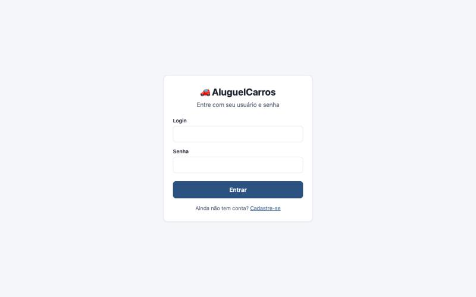 | 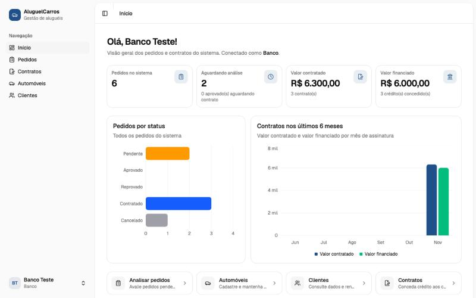 |
| **Pedidos (visão do agente)** | **Detalhe do pedido (linha do tempo)** |
| 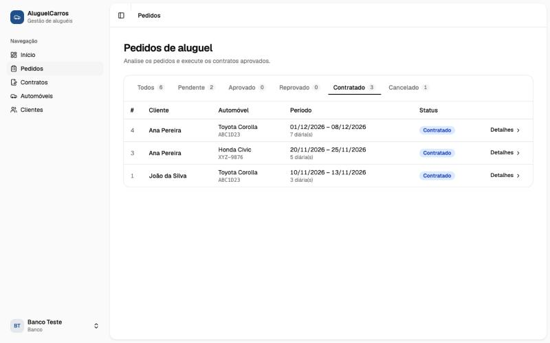 | 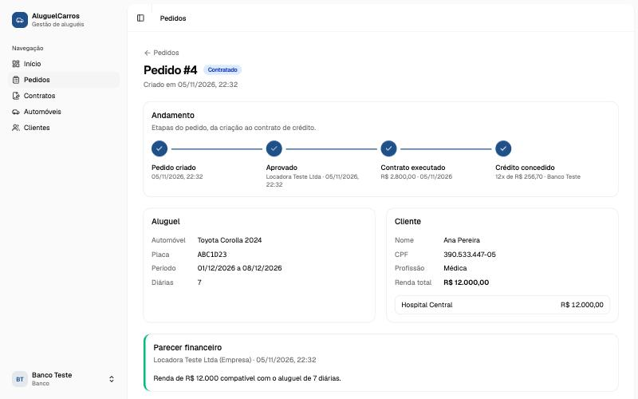 |
| **Contrato e crédito** | **Contratos** |
| 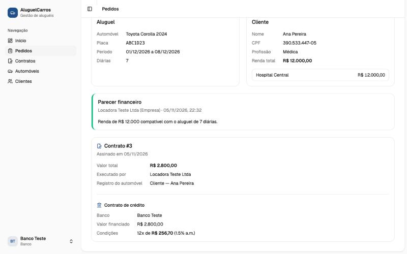 | 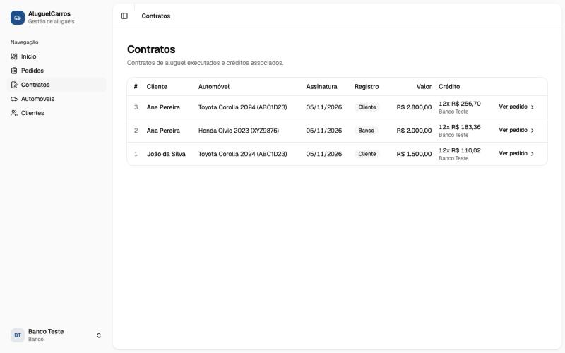 |
| **Novo pedido (cliente)** | **Meus dados e rendimentos (cliente)** |
| 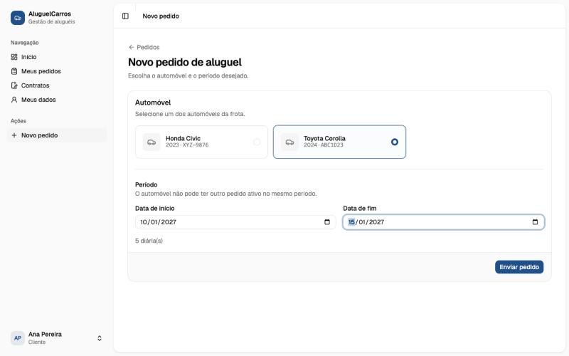 | 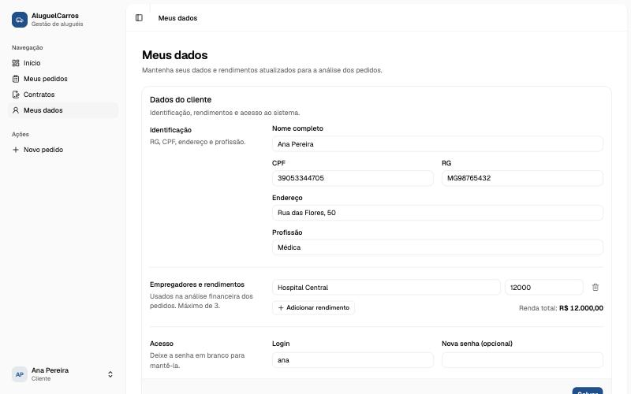 |
| **Automóveis (agente)** | **Avaliação de pedido pendente** |
| 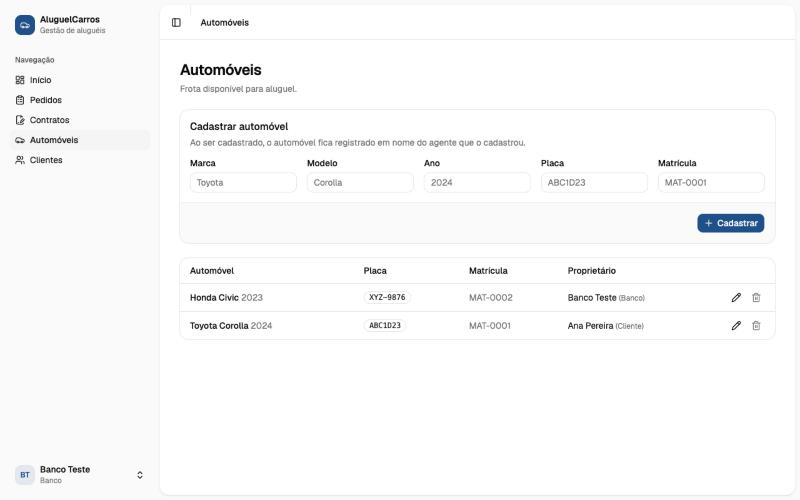 | 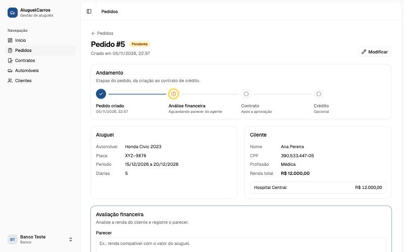 |

### 💻 Exemplo de Saída no Terminal (API)

```bash
# 1. Login (retorna o token JWT)
curl -X POST http://localhost:8080/api/auth/login \
     -H 'Content-Type: application/json' \
     -d '{"login":"ana","senha":"123456"}'

# 2. Lista os pedidos do usuário logado
curl http://localhost:8080/api/pedidos -H 'Authorization: Bearer <token>'
```

**Saída esperada (resumida):**
```json
[
  {
    "id": 3,
    "status": "CONTRATADO",
    "dataInicio": "2026-11-20",
    "dataFim": "2026-11-25",
    "diarias": 5,
    "automovel": { "marca": "Honda", "modelo": "Civic", "placa": "XYZ9876" },
    "parecer": "Renda de R$ 12.000 comporta o aluguel. Aprovado.",
    "contrato": {
      "valorTotal": 2000.00,
      "tipoProprietario": "BANCO",
      "credito": { "valor": 2000.00, "taxaJuros": 1.5, "numeroParcelas": 12, "valorParcela": 183.36 }
    }
  }
]
```

Erros seguem um formato único:
```json
{ "status": 400, "mensagem": "O automóvel já está reservado em parte deste período.", "erros": {} }
```

---

## 🧪 Testes

### Testes Unitários e de Integração (back-end)

```bash
cd backend
./mvnw test
```
*Ferramentas: JUnit 5, AssertJ e Mockito.*

| Classe de teste | O que verifica |
| :--- | :--- |
| `PedidoAluguelTest` | Ciclo de vida do pedido: criação PENDENTE, validação de período, aprovar/reprovar, contratar, cancelar e modificar. |
| `ClienteTest` | Limite de 3 rendimentos, renda total e perfis dos usuários. |
| `ContratoCreditoTest` | Cálculo da parcela (Tabela Price e sem juros). |
| `PedidoServiceTest` | Conflito de datas, início no passado, permissões de cliente/agente. |
| `ContratoServiceTest` | Registro do automóvel no contrato, crédito somente por banco e limitado ao valor do contrato. |
| `AluguelCarrosApplicationTests` | Integração: sobe o contexto Spring, aplica as migrações e valida o mapeamento JPA contra o banco (requer `backend/.env`). |

### Qualidade do front-end

```bash
cd frontend
npm run lint
npm run build
```

---

## 🔗 Documentações utilizadas

* 📖 **Back-end:** [Documentação do **Spring Boot**](https://docs.spring.io/spring-boot/index.html)
* 📖 **Segurança:** [Spring Security — **OAuth2 Resource Server / JWT**](https://docs.spring.io/spring-security/reference/servlet/oauth2/resource-server/jwt.html)
* 📖 **Persistência:** [Spring Data JPA](https://docs.spring.io/spring-data/jpa/reference/) e [Flyway](https://documentation.red-gate.com/flyway)
* 📖 **Banco de Dados:** [Documentação do **Supabase**](https://supabase.com/docs)
* 📖 **Front-end:** [Documentação do **React**](https://react.dev/reference/react) e [React Router](https://reactrouter.com/)
* 📖 **Build Tool:** [Guia do **Vite**](https://vitejs.dev/guide/)
* 📖 **Interface:** [**shadcn/ui**](https://ui.shadcn.com/docs) e [Tailwind CSS](https://tailwindcss.com/docs)
* 📖 **Modelagem:** [PlantUML](https://plantuml.com/) e leitura sobre [Diagrama de Pacotes](https://www.uml-diagrams.org/package-diagrams.html)

---

## 👥 Autores

| 👤 Nome | :octocat: GitHub |
|---------|-----------------|
| Guilherme Costa | <div align="center"><a href="https://github.com/GuilhermeCostax"></a></div> |

---

## 🤝 Contribuição

1. Faça um `fork` do projeto.
2. Crie uma branch para sua feature (`git checkout -b feature/minha-feature`).
3. Commit suas mudanças (`git commit -m 'feat: adiciona nova funcionalidade X'`), seguindo [Conventional Commits](https://www.conventionalcommits.org/pt-br/v1.0.0/).
4. Faça o `push` para a branch (`git push origin feature/minha-feature`).
5. Abra um **Pull Request**.

---

## 🙏 Agradecimentos

* [**Engenharia de Software PUC Minas**](https://www.instagram.com/engsoftwarepucminas/) — pelo apoio institucional e pela estrutura acadêmica.
* [**Prof. Dr. João Paulo Aramuni**](https://github.com/joaopauloaramuni) — pelos ensinamentos em **Desenvolvimento e Integração de Aplicações Web**, pelo enunciado do laboratório e pelo template deste README.

---

## 📄 Licença

Projeto acadêmico desenvolvido para a disciplina DIAW da PUC Minas, distribuído sob a **[Licença MIT](LICENSE)**.

---
